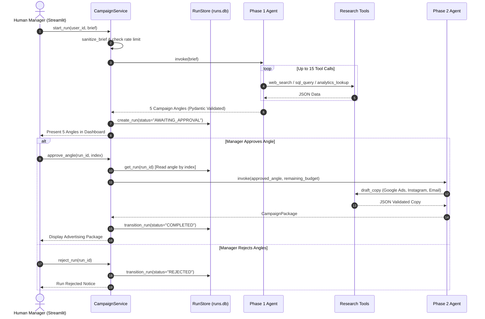
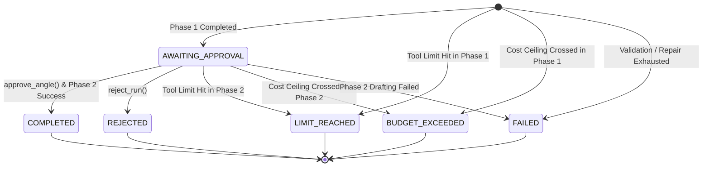

# Marketing Campaign Agent: Architecture Document

## 1. System Overview

The Marketing Campaign Agent is a bounded, tool-using AI agent built with **LangChain 1.4 (`create_agent`)**, **Pydantic v2**, and **Streamlit**. It assists a fictional retailer's marketing team ("Brightside Goods") by executing market research, querying an internal customer database for demographic insights, calculating channel reach, presenting 5 candidate angles to a human manager, and drafting advertising copy for an approved angle.

```
                      Streamlit dashboard (app.py)
                 user id · product form · 5 angle cards · approve/reject · package · cost · trace
                                   │ service.py (the only orchestrator)
        ┌──────────────────────────┼──────────────────────────────┐
        ▼                          ▼                              ▼
  ratelimit.py              store.py (runs.db)             trace_log.py (JSONL)
  sanitize.py               run state machine              every tool call + model step
        │
        ▼ PHASE 1                                           PHASE 2 (only after approve_angle)
  create_agent(model, tools, middleware)                     create_agent(model, tools, middleware)
    middleware: ToolCallLimit(15 − used) · ModelCallLimit · CostCeiling(0.25 − spent) · Trace
    tools: web_search  sql_query  analytics_lookup           tools: draft_copy  analytics_lookup
        │                                                          │
        ▼                                                          ▼
  final message ─► CampaignAngles (Pydantic, exactly 5)      final message ─► CampaignPackage (Pydantic)

 tools ──► search_backends (fixture | ddgs)   sqlsafe.py ─► db.py (customers.db, mode=ro + query_only + authorizer)
 every SQL string ──► audit/sql_audit.jsonl (accepted or rejected, reason, no row data)
 LangSmith: automatic LangChain tracing when LANGSMITH_TRACING=true
```

---

## 2. Two-Phase Agent & Human-In-The-Loop Gate

The workflow is decoupled into two distinct agent invocations coordinated by `src/campaign/service.py`:



### Human Gate Security (S10)
Phase 2 reads the approved angle directly from persistent storage in `runs.db` by integer index (`0..4`). It never accepts angle titles or copy from user interface payloads, preventing client-side tampering.

---

## 3. Persistent State Machine (`store.py`)

Run execution state is tracked in SQLite (`data/runs.db`) to ensure process restart safety:



State transitions are strictly verified: only runs in `AWAITING_APPROVAL` may transition to terminal states. Attempting to transition from terminal states raises `InvalidTransition`.

---

## 4. Shared Allowance & Middleware Pipeline

Both phases share a unified resource ceiling:
1. **15 Tool Calls**: Controlled via LangChain `ToolCallLimitMiddleware(run_limit=remaining, exit_behavior="end")`.
   - Phase 1 receives 15 calls.
   - Phase 2 receives `15 - tool_calls_used`.
   - The 16th tool call is intercepted by middleware and emits a blocker tool message; subsequent tools are not executed.
2. **$0.25 Cost Ceiling**: Tracked by `CostCeilingMiddleware`.
   - Calculates notional cost after each model turn ($1.50/M input, $7.50/M output).
   - If total cost crosses $0.25, `BudgetExceeded` is raised from `after_model`, terminating the run cleanly.
   - Worst-case overshoot is mathematically bounded by `max_output_tokens` (2,048 tokens = ~$0.015).
3. **Model Call Limiter**: Bounded by `ModelCallLimitMiddleware(run_limit=20)`.
4. **Trace Middleware**: Records step-by-step token counts, latencies, truncated arguments, and SHA-256 digests into append-only JSONL files.

---

## 5. Three-Layer Read-Only SQLite Security Boundary

To defend against SQL injection and unintended data modifications, database queries pass through three independent enforcement layers:

1. **OS / File Lock Layer**: Opened using URI `file:data/customers.db?mode=ro`. The operating system enforces read-only file locks.
2. **Engine Layer**: `PRAGMA query_only = ON` is executed on every new connection before any query.
3. **Bytecode Compiler Authorizer**: `sqlite3.set_authorizer` permits only `SQLITE_SELECT`, `SQLITE_READ`, and `SQLITE_FUNCTION`. All data-definition (`CREATE`, `DROP`, `ALTER`), data-manipulation (`INSERT`, `UPDATE`, `DELETE`), system (`ATTACH`, `PRAGMA`), and recursive CTE queries (`SQLITE_RECURSIVE`) are rejected at the compiler level.
4. **VM Step Limit**: A progress handler aborts runaway queries after 1,000,000 virtual machine instructions.
5. **Fail-Closed Audit Log**: Every query attempt (accepted or rejected) is recorded in `audit/sql_audit.jsonl`. If writing to the audit log fails, the database query fails closed.

---

## 6. Observability and Telemetry Architecture

1. **Structured JSON Logging**: Managed via `structlog`, binding contextvars `run_id` and `phase`. Sensitive keys (passwords, tokens, product text, customer rows) are redacted.
2. **Append-Only Trace Logger (`logs/agent_trace.jsonl`)**: Thread-safe writer capturing all model steps (tokens, notional costs, SHA-256 digests) and tool calls (tool, truncated args, ok flag, error code, duration in milliseconds).
3. **LangSmith Integration**: When `LANGSMITH_TRACING=true` and `LANGSMITH_API_KEY` are provided, LangChain runnables attach `run_name`, `tags=["campaign-agent", phase]`, and `metadata={"run_id": ..., "phase": ...}` to external traces.
